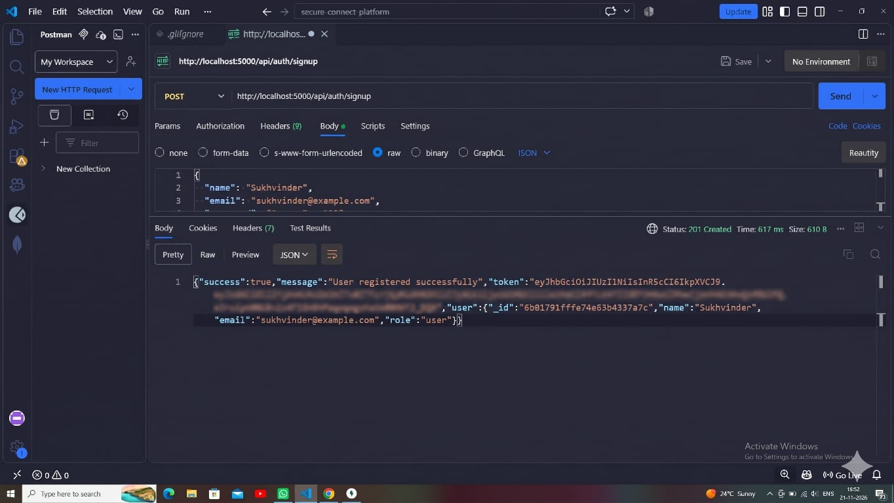
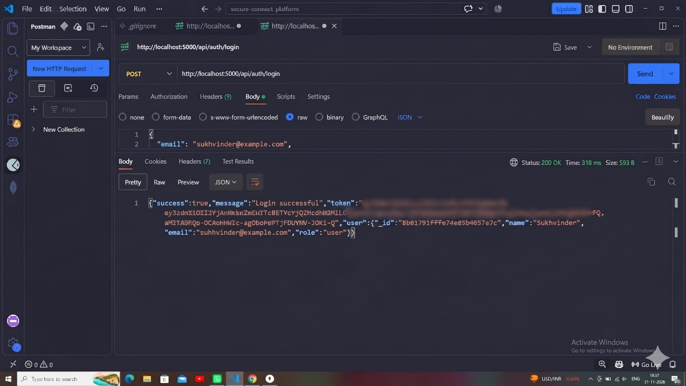
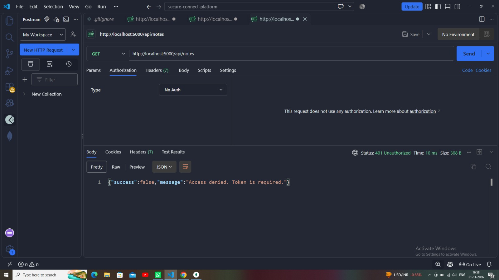
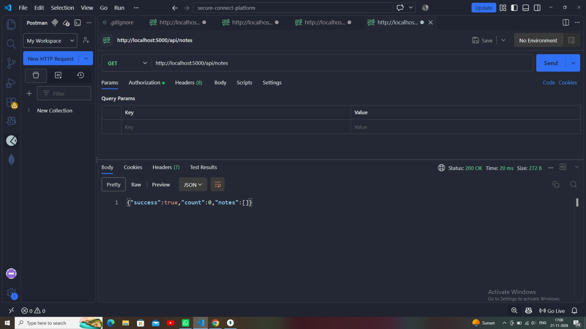
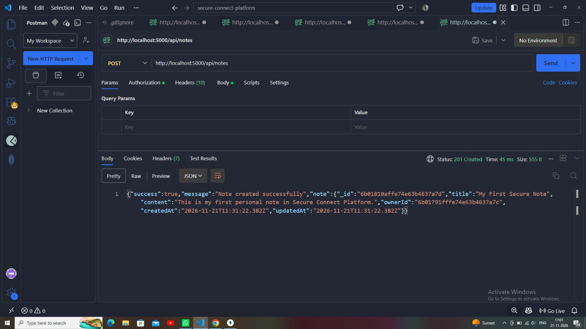
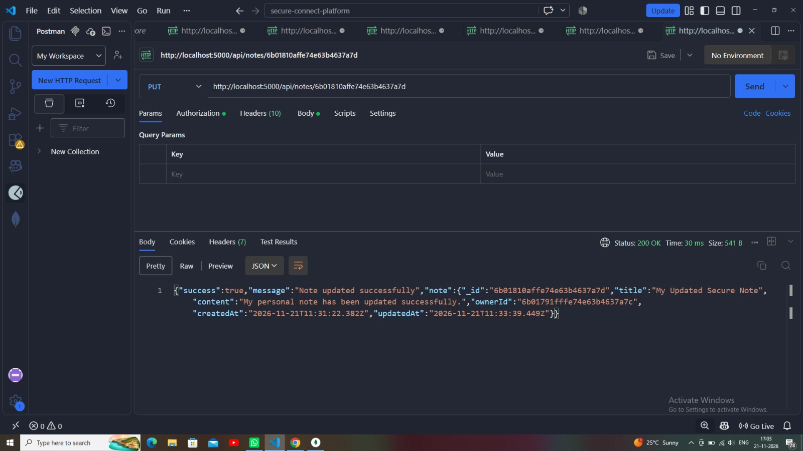
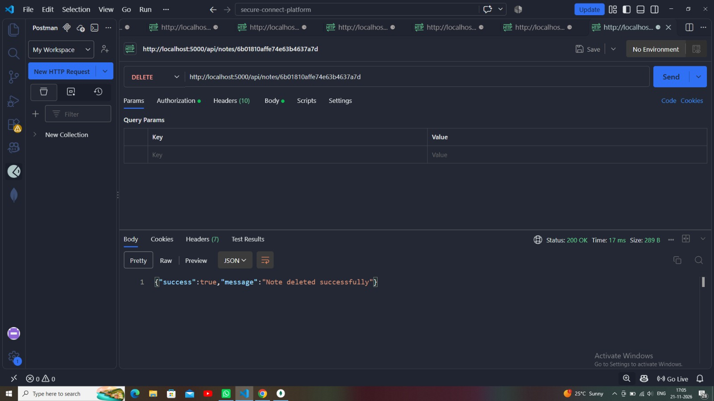
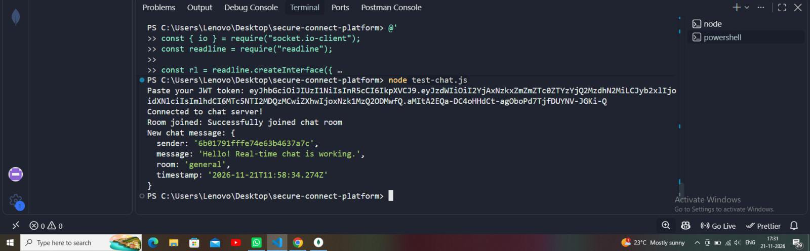
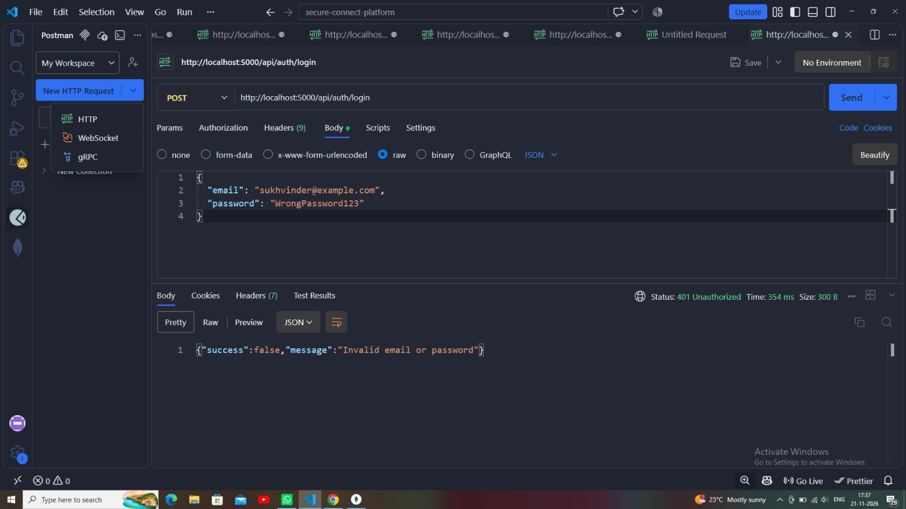
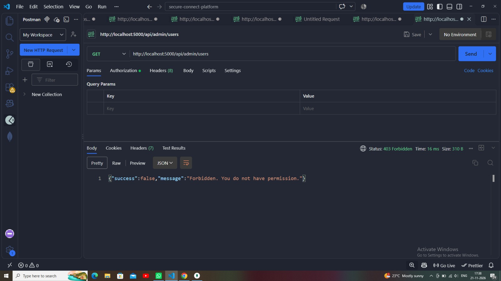

# Secure Connect and Communication Platform

A secure backend application developed using Node.js, Express.js, MongoDB and Socket.IO. The platform provides secure user authentication, protected personal notes, role-based access control and real-time communication.

## Features

- User Registration and Login
- Password Hashing using bcrypt
- JWT-based Authentication
- Protected API Routes
- Secure Notes CRUD Operations
- Role-Based Access Control (RBAC)
- Real-Time Chat using Socket.IO
- Event-Driven Architecture using EventEmitter
- Environment Variable Management using dotenv

## Technologies Used

| Technology | Purpose |
|---|---|
| Node.js | Backend Runtime |
| Express.js | REST API Development |
| MongoDB | Database |
| bcrypt | Password Hashing |
| JSON Web Token | Authentication |
| Socket.IO | Real-Time Communication |
| EventEmitter | Event-Driven Programming |
| dotenv | Environment Configuration |

## Project Structure

```text
secure-connect-platform/
│
├── config/
│   └── database.js
│
├── controllers/
│   ├── authController.js
│   └── notesController.js
│
├── events/
│   └── appEvents.js
│
├── middleware/
│   ├── authMiddleware.js
│   └── roleMiddleware.js
│
├── models/
│   ├── User.js
│   └── Note.js
│
├── routes/
│   ├── authRoutes.js
│   └── notesRoutes.js
│
├── sockets/
│   └── chatSocket.js
│
├── screenshots/
│   ├── 01-signup.jpeg
│   ├── 02-login.jpeg
│   ├── 03-unauthorized-access.jpeg
│   ├── 04-authorized-access.jpeg
│   ├── 05-create-note.jpeg
│   ├── 06-update-note.jpeg
│   ├── 07-delete-note.jpeg
│   ├── 08-realtime-chat.jpeg
│   ├── 09-invalid-login.jpeg
│   └── 10-rbac-access-denied.jpeg
│
├── .env
├── .gitignore
├── server.js
├── test-chat.js
├── package.json
└── README.md
```

## Installation and Setup

### 1. Clone the Repository

```bash
git clone YOUR_GITHUB_REPOSITORY_URL
cd secure-connect-platform
```

### 2. Install Dependencies

```bash
npm install
```

### 3. Configure Environment Variables

Create a `.env` file in the root directory.

```env
PORT=5000
MONGODB_URI=mongodb://127.0.0.1:27017/secure_connect_platform
JWT_SECRET=your_strong_random_secret
JWT_EXPIRES_IN=1d
```

Use a strong, private JWT secret. Never upload your actual `.env` file to GitHub.

### 4. Start the Server

```bash
node server.js
```

Server URL:

```text
http://localhost:5000
```

## API Documentation

Base URL: `http://localhost:5000`

### Authentication APIs

| Method | Endpoint | Description |
|---|---|---|
| POST | `/api/auth/signup` | Register a new user |
| POST | `/api/auth/login` | Login user |
| GET | `/api/auth/me` | Get authenticated user details |

### Notes APIs

All Notes endpoints require a valid JWT Bearer Token.

| Method | Endpoint | Description |
|---|---|---|
| POST | `/api/notes` | Create a new note |
| GET | `/api/notes` | Get all personal notes |
| GET | `/api/notes/:id` | Get a specific note |
| PUT | `/api/notes/:id` | Update an existing note |
| DELETE | `/api/notes/:id` | Delete a note |

### Admin API

| Method | Endpoint | Description |
|---|---|---|
| GET | `/api/admin/users` | Get all users (Admin role required) |

## Authentication and Security

- Passwords are securely hashed using bcrypt.
- JWT tokens are used for user authentication.
- Protected routes verify authentication tokens.
- Users can access only their own notes.
- Role-based middleware restricts admin-only operations.
- Sensitive configuration is managed through environment variables.

## Real-Time Chat

Socket.IO is used to implement real-time communication between connected users.

### Socket Events

| Event | Description |
|---|---|
| `connection` | Establish a socket connection |
| `chat:join` | Join a chat room |
| `chat:joined` | Confirm successful room joining |
| `chat:message` | Send and receive chat messages |
| `chat:error` | Handle chat validation errors |
| `disconnect` | Handle socket disconnection |

Socket connections are authenticated using JWT tokens.

### Chat Testing

The Socket.IO connection and messaging functionality can be tested using:

```bash
node test-chat.js
```

## Application Screenshots

### 1. User Signup



### 2. User Login



### 3. Unauthorized Access Without Token



### 4. Authorized Access With Token



### 5. Create Secure Note



### 6. Update Secure Note



### 7. Delete Secure Note



### 8. Real-Time Chat Using Socket.IO



### 9. Invalid Login



### 10. Role-Based Access Control



## Testing Summary

The following functionalities have been tested:

- User registration and login
- Invalid login authentication
- Protected routes without authentication
- Protected routes with valid JWT tokens
- Create, Read, Update and Delete operations
- Role-based access restrictions
- Socket.IO connection and room joining
- Real-time message exchange

## Author

**Sukhvinder Kaur**

B.Tech – Computer Science and Engineering

## License

This project was developed for academic purposes.
